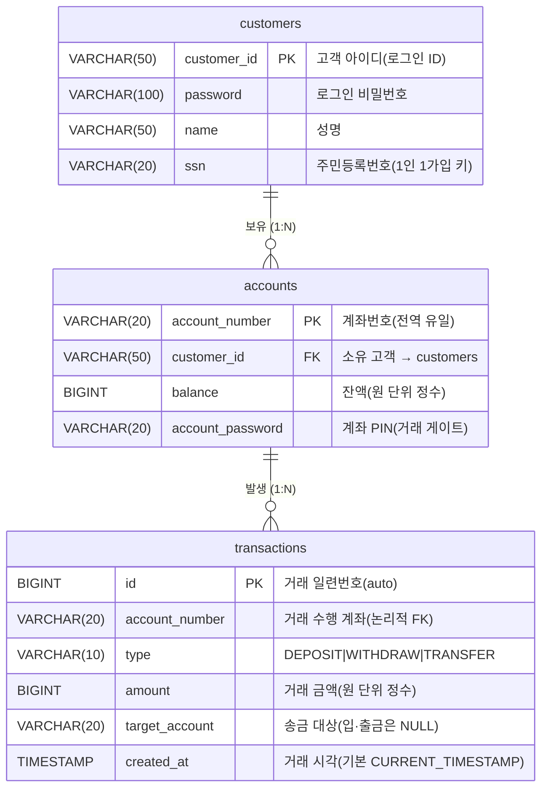

# DB_DESIGN.md — 데이터베이스 설계 문서

> BankingSystem의 데이터 모델(ERD)·키 설계·DBMS 선택 근거를 정리한 문서.
> 실제 스키마는 [`src/Database.java`](src/Database.java)의 `init()`이 진실의 원천이며, 이 문서는 그 **설계 의도**를 기록한다.
> 운영/디버깅(스키마 리셋, H2 콘솔 접속)은 [CLAUDE.md](CLAUDE.md)의 "Database" 절 참고.

---

## ★ 핵심 요약 (PPT 1장)

> **고객·계좌·거래** 3개 엔터티를 도출한 뒤 **속성 → 관계 → 식별자** 순으로 설계하고, 제약조건을 더해 DDL로 확정했다.

**① 엔터티 도출** — 요구사항의 명사에서 *고객(customers)·계좌(accounts)·거래(transactions)* 3개를 추출. (은행=행위라 제외)

**② 속성·관계·식별자 설정**
- 관계: `고객 1—N 계좌`, `계좌 1—N 거래` (고객→계좌→거래로 흐르는 단순 정규화 구조)
- **필수키(PK)는 각 엔터티의 식별자로 설정** — `customers.customer_id`(로그인 ID), `accounts.account_number`(전역 유일 계좌번호)는 **자연 키**, `transactions.id`는 **인조 키(AUTO_INCREMENT)**.
- 외래키(FK): `accounts.customer_id → customers`(강한 FK). 거래 테이블의 계좌 참조는 append-only 로그라 **논리적 FK**로만 둠.

**③ 제약조건 + DDL 작성** — PK/FK·`NOT NULL`·`DEFAULT`·금액 `BIGINT`(원 단위 정수, 부동소수점 오차 제거)를 적용해 아래 DDL 확정.

```sql
CREATE TABLE customers (
    customer_id VARCHAR(50)  PRIMARY KEY,          -- PK(자연 키)
    password    VARCHAR(100) NOT NULL,
    name        VARCHAR(50)  NOT NULL,
    ssn         VARCHAR(20)  NOT NULL               -- 1인 1가입 키
);
CREATE TABLE accounts (
    account_number   VARCHAR(20) PRIMARY KEY,        -- PK(자연 키)
    customer_id      VARCHAR(50) NOT NULL,
    balance          BIGINT      NOT NULL DEFAULT 0, -- 금액=정수
    account_password VARCHAR(20) NOT NULL,           -- 거래 PIN
    FOREIGN KEY (customer_id) REFERENCES customers(customer_id)  -- 강한 FK
);
CREATE TABLE transactions (
    id             BIGINT AUTO_INCREMENT PRIMARY KEY,-- PK(인조 키)
    account_number VARCHAR(20) NOT NULL,
    type           VARCHAR(10) NOT NULL,             -- DEPOSIT|WITHDRAW|TRANSFER
    amount         BIGINT      NOT NULL,
    target_account VARCHAR(20),                      -- 송금 대상(입·출금 NULL)
    created_at     TIMESTAMP   DEFAULT CURRENT_TIMESTAMP
);
```

**DBMS = H2(임베디드)** — JAR 하나로 무설정 실행 + 파일 영속 + 표준 JDBC. 송금은 단일 공유 커넥션의 `commit/rollback`으로 **원자적** 처리.

> IE 표기법(Information Engineering / 까마귀발) ERD는 [`무제 폴더/images/db-erd-ie.png`](무제 폴더/images/db-erd-ie.png) 참고 (drawio 원본: `무제 폴더/DB-ERD-IE.drawio`).

---

## 0. 한눈에 보기 (최종 ERD)



3개 테이블, 2개의 1:N 관계. **고객 → 계좌 → 거래**로 이어지는 단순·정규화된 구조다.

---

# Part 1. ERD 작성 6단계에 따른 설계 과정

데이터 모델링 표준 절차(엔터티 → 속성 → 관계 → 식별자 → 정규화 → 검토)를 이 프로젝트에 적용한 기록.

## 1단계 — 엔터티 도출 (무엇을 저장할 것인가)

요구사항("고객이 가입하고, 계좌를 만들고, 입금·출금·송금 거래를 한다")에서 **명사**를 추출해 엔터티 후보를 찾았다.

| 후보 명사 | 엔터티 채택 여부 | 판단 |
|-----------|:---:|------|
| 고객(Customer) | ✅ `customers` | 가입 주체. 독립적으로 식별·저장 필요 |
| 계좌(Account) | ✅ `accounts` | 잔액을 가진 핵심 자원 |
| 거래(Transaction) | ✅ `transactions` | 입·출금·송금 **이력**을 영구 보존해야 함 |
| 은행(Bank) | ❌ | 서비스 로직(행위)일 뿐, 저장할 상태가 없음 → 클래스로만 존재 |
| 금액/잔액 | ❌ | 엔터티가 아니라 **속성**(accounts.balance, transactions.amount) |
| 비밀번호/PIN | ❌ | 속성(고객 password, 계좌 account_password) |

→ **최종 엔터티 3개: customers, accounts, transactions.** (교수님 ~10개 클래스 제약과 동일한 "최소 구성" 철학)

## 2단계 — 속성 도출 (각 엔터티가 가질 데이터)

각 엔터티에 필요한 속성과 도메인(타입)을 정의했다.

- **customers**: `customer_id`(아이디), `password`, `name`, `ssn`
  - `ssn`을 둔 이유: **"1인 1가입"** 업무 규칙을 강제하기 위한 자연 키. 가입 시 동일 주민번호 존재 여부로 차단(`existsBySsn`).
- **accounts**: `account_number`, `customer_id`(소유자), `balance`, `account_password`(거래 PIN)
  - 로그인 비밀번호(customers.password)와 **계좌 PIN(account_password)을 분리** — 인증 단계가 2겹(로그인 게이트 + 거래 게이트).
- **transactions**: `account_number`, `type`, `amount`, `target_account`, `created_at` (+ 일련번호 `id`)
  - `type`은 `DEPOSIT|WITHDRAW|TRANSFER` 세 값. `target_account`는 송금일 때만 채워지고 입·출금은 NULL.

## 3단계 — 관계 도출 (엔터티 간 연결과 카디널리티)

| 관계 | 카디널리티 | 의미 | 비고 |
|------|:---:|------|------|
| customers ─ accounts | **1 : N** | 한 고객이 여러 계좌를 가질 수 있음 | 스키마는 1:N 허용. 단, **앱 규칙으로 "1인 1계좌"** 강제(`existsAccountByCustomer`) |
| accounts ─ transactions | **1 : N** | 한 계좌에서 여러 거래가 발생 | 거래는 반드시 한 계좌에 귀속 |

> **설계 판단:** "1인 1계좌"를 *스키마 제약(UNIQUE)* 이 아니라 *서비스 로직* 으로 둔 이유 —
> 향후 다계좌 확장 시 스키마 변경 없이 정책만 풀면 되도록 유연성을 남겼다(데모 범위에선 서비스 가드로 충분).

## 4단계 — 식별자(키) 확정

각 엔터티의 주식별자(PK)와 참조(FK)를 결정했다. (상세는 **Part 2** 참고)

- `customers.customer_id` → 주식별자(자연 키: 로그인 아이디)
- `accounts.account_number` → 주식별자(전역 유일 계좌번호) + `customer_id`는 외래 식별자
- `transactions.id` → **인조 키**(AUTO_INCREMENT). 거래는 자연 키가 마땅치 않아 일련번호를 PK로 도입

## 5단계 — 정규화 검토

제3정규형(3NF) 기준으로 점검했다.

- **1NF**: 모든 속성이 원자값(다치/반복 그룹 없음). ✅ — `transactions`를 별도 테이블로 분리해 "계좌에 거래 목록을 욱여넣는" 반복 그룹을 제거.
- **2NF**: 부분 함수 종속 없음(복합 PK가 없으므로 자동 충족). ✅
- **3NF**: 이행 종속 없음. ✅ — 예: `customers`의 `name`은 `customer_id`에만 종속. 계좌 잔액을 고객 테이블에 중복 저장하지 않음.
- **의도적 비정규화 없음**: 잔액(`balance`)은 `accounts`에만, 거래 금액(`amount`)은 `transactions`에만 둬 **단일 출처(SSOT)** 유지.

## 6단계 — 통합·검토 (최종 ERD 확정)

위 결과를 합쳐 0절의 ERD로 확정했다. 추가 검토 사항:

- `transactions.account_number`/`target_account`는 **논리적으로 accounts를 참조**하지만, 실제 DDL에는 FK 제약을 걸지 않았다.
  - 이유: 거래 이력은 **불변 로그(append-only)** 성격이라 참조 무결성보다 기록 보존이 우선. (송금 대상이 외부/시드 계좌일 수 있어 강한 FK가 오히려 제약이 됨)
  - 정합성은 서비스 계층(`Bank.transfer`가 `findAccount`로 대상 존재 확인)에서 보장.
- 모든 거래는 **PIN 게이트 통과 후에만** `transactions`에 INSERT → 실패 거래는 테이블에 흔적이 남지 않는다(불변식).

---

# Part 2. 키·제약·타입 설계

## 2-1. 기본키(PK) 설계

| 테이블 | PK | 종류 | 선택 근거 |
|--------|-----|------|-----------|
| `customers` | `customer_id` | 자연 키 | 로그인 아이디가 이미 유일·불변 → 별도 인조 키 불필요 |
| `accounts` | `account_number` | 자연 키 | 계좌번호는 업무상 전역 유일(`100-1000`, `100-1001`…). 고객과 무관하게 단독 식별 |
| `transactions` | `id` | **인조 키(AUTO_INCREMENT)** | 거래는 (계좌+시각)도 충돌 가능 → 안전하게 일련번호 사용. 최신순 정렬(`ORDER BY id DESC`)에도 활용 |

## 2-2. 외래키(FK) 설계

| FK | 참조 | 강제 방식 | 비고 |
|----|------|-----------|------|
| `accounts.customer_id` → `customers.customer_id` | 소유 고객 | **DDL FK 제약(강함)** | 고객 없는 계좌 생성 불가 — DB가 직접 보장 |
| `transactions.account_number` → `accounts.account_number` | 거래 계좌 | **논리적(약함)** | append-only 로그라 FK 미설정, 서비스에서 정합성 확보 |
| `transactions.target_account` → `accounts.account_number` | 송금 대상 | **논리적(약함)** | 입·출금 시 NULL 허용이라 FK 부적합 |

## 2-3. 컬럼 제약 요약

| 테이블 | 컬럼 | 타입 | 제약 |
|--------|------|------|------|
| customers | customer_id | VARCHAR(50) | PK |
| | password | VARCHAR(100) | NOT NULL |
| | name | VARCHAR(50) | NOT NULL |
| | ssn | VARCHAR(20) | NOT NULL (1인 1가입 검사용) |
| accounts | account_number | VARCHAR(20) | PK |
| | customer_id | VARCHAR(50) | NOT NULL, FK→customers |
| | balance | **BIGINT** | NOT NULL, DEFAULT 0 |
| | account_password | VARCHAR(20) | NOT NULL |
| transactions | id | BIGINT | PK, AUTO_INCREMENT |
| | account_number | VARCHAR(20) | NOT NULL |
| | type | VARCHAR(10) | NOT NULL (DEPOSIT/WITHDRAW/TRANSFER) |
| | amount | **BIGINT** | NOT NULL |
| | target_account | VARCHAR(20) | NULL 허용(입·출금) |
| | created_at | TIMESTAMP | DEFAULT CURRENT_TIMESTAMP |

## 2-4. 금액 타입을 `BIGINT`(=Java `long`)로 결정한 이유 ⭐

처음엔 `DECIMAL(15,2)` / Java `double`이었으나 **`BIGINT` / `long`(원 단위 정수)으로 마이그레이션**했다.

- **부동소수점 오차 제거**: `double`은 `0.1 + 0.2 ≠ 0.3` 류 오차가 발생 → 금융 금액에 부적합.
- **모델-DB 타입 일치**: Java `long` ↔ H2 `BIGINT`가 1:1 대응 → `setLong/getLong`으로 변환 손실 없음.
- **원화 특성**: 원(₩)은 보조단위(전)를 쓰지 않아 **정수로 충분**. 소수 자릿수가 필요 없다.
- 코드 영향: `Account.balance`, `TransactionRecord.amount`, 모든 거래 파라미터가 `long`. `nextDouble/setDouble` 재도입 금지(CLAUDE.md 불변식).

> ⚠️ **마이그레이션 주의:** `CREATE TABLE IF NOT EXISTS`는 기존 컬럼 타입을 바꾸지 않으므로, DECIMAL→BIGINT 전환 후 기존 `./data/bank.mv.db`는 **삭제 후 재생성** 필요 (`rm -rf data`).

---

# Part 3. DBMS 선택 — 왜 H2인가

## 3-1. 선택지 비교

| 후보 | 장점 | 이 프로젝트엔 |
|------|------|-------------|
| **H2 (임베디드)** | JAR 하나로 끝, 서버 불필요, 표준 SQL/JDBC, 파일·메모리 모드 | ✅ **채택** |
| SQLite | 초경량 | JDBC 생태계·동시 콘솔 접속은 H2가 더 매끄러움 |
| MySQL/PostgreSQL | 운영급 기능 | 별도 서버 설치·구동 필요 → 콘솔 데모/제출에 과함 |
| 순수 메모리(컬렉션) | 의존성 0 | **영속성 없음** — 재실행 시 데이터 소멸, "은행"엔 부적합 |

## 3-2. H2를 고른 핵심 이유

1. **무설정 임베디드** — `lib/h2-*.jar`만 클래스패스에 있으면 됨. 팀원·교수가 **서버 설치 없이** 바로 실행(IntelliJ/Eclipse 공통).
2. **파일 모드 영속성** — `jdbc:h2:./data/bank` → `./data/bank.mv.db` 파일에 상태 보존. 재실행해도 가입·계좌·거래가 유지(로그인 시 DB에서 계좌 복원).
3. **표준 JDBC** — `DriverManager`, `PreparedStatement`, `setLong/getLong` 등 표준 API만 사용 → 추후 다른 RDBMS로 갈아타도 코드 변경 최소(DIP와 결).
4. **`AUTO_SERVER=TRUE`** — 앱이 DB 파일을 잡고 있는 동안에도 **H2 콘솔/IntelliJ에서 동시 접속**해 내부를 들여다볼 수 있음(디버깅에 유용).
5. **번들 도구** — 추가 설치 없이 `org.h2.tools.Console`(웹 콘솔), `org.h2.tools.Shell`(CLI 쿼리) 제공.

## 3-3. 연결 구성 (`Database.java`)

```
URL  : jdbc:h2:./data/bank;AUTO_SERVER=TRUE
USER : sa     PASSWORD : (빈 문자열)
```

- **단일 공유 정적 커넥션**: `private static Connection connection;` 을 전체가 공유.
  - 이유: 트랜잭션 경계를 **한 커넥션에 모아야** auto-commit 토글로 원자성 제어가 가능(아래 3-4).
- `getConnection()`은 끊겨 있으면 재연결, `init()`은 시작 시 1회 스키마 생성, `close()`는 종료 시 정리.

## 3-4. 트랜잭션 경계 — 송금 원자성의 토대 ⭐

송금은 **출금 계좌 UPDATE + 입금 계좌 UPDATE + 거래이력 INSERT** 3개가 **전부 성공하거나 전부 무효**여야 한다(돈 증발 방지).

```java
// H2BankRepository.runInTransaction — 단일 공유 커넥션의 auto-commit을 끄고 묶는다
c.setAutoCommit(false);
work.run();        // updateBalance(출금) + updateBalance(입금) + insertHistory
c.commit();        // 셋 다 성공해야 확정
// 도중 예외 → c.rollback() 으로 전부 되돌림 → transactions에 흔적 없음
```

- 이 경계가 **단일 공유 커넥션**을 전제로 동작(여러 커넥션이면 같은 트랜잭션으로 못 묶음) → 3-3의 설계와 직결.
- `TransactionTemplate.run()`의 4단계 중 ④(영속화)만 이 `runInTransaction`으로 감싸진다 → 도메인 연산(③)은 DB를 모름(SRP).
- **정직한 한계:** rollback 시 메모리상 `Account` 잔액은 이미 바뀐 채로 남아 DB와 일시 괴리(앱 재로딩 시 일치). 콘솔 데모 범위에선 수용(CLAUDE.md "Atomicity" 절 참고).

---

## 부록 A. 실제 DDL (Database.init())

```sql
CREATE TABLE IF NOT EXISTS customers (
    customer_id VARCHAR(50)  PRIMARY KEY,
    password    VARCHAR(100) NOT NULL,
    name        VARCHAR(50)  NOT NULL,
    ssn         VARCHAR(20)  NOT NULL
);

CREATE TABLE IF NOT EXISTS accounts (
    account_number   VARCHAR(20) PRIMARY KEY,
    customer_id      VARCHAR(50) NOT NULL,
    balance          BIGINT      NOT NULL DEFAULT 0,
    account_password VARCHAR(20) NOT NULL,
    FOREIGN KEY (customer_id) REFERENCES customers(customer_id)
);

CREATE TABLE IF NOT EXISTS transactions (
    id             BIGINT AUTO_INCREMENT PRIMARY KEY,
    account_number VARCHAR(20) NOT NULL,
    type           VARCHAR(10) NOT NULL,
    amount         BIGINT      NOT NULL,
    target_account VARCHAR(20),
    created_at     TIMESTAMP   DEFAULT CURRENT_TIMESTAMP
);
```

## 부록 B. DB 점검 명령

```bash
# 웹 콘솔 (http://localhost:8082, user "sa", 빈 비밀번호)
java -cp "lib/*" org.h2.tools.Console

# 한 줄 쿼리 — 계좌/거래 확인
java -cp "lib/*" org.h2.tools.Shell -url "jdbc:h2:./data/bank;AUTO_SERVER=TRUE" \
  -user sa -password "" -sql "SELECT * FROM CUSTOMERS; SELECT * FROM accounts; SELECT * FROM transactions"

# 스키마 리셋 (타입 변경 후 필수)
rm -rf data
```

## 부록 C. 무결성 불변식 점검 포인트

| 불변식 | 보장 위치 | 확인법 |
|--------|-----------|--------|
| 고객 없는 계좌 불가 | DDL FK(accounts→customers) | FK 위반 INSERT가 거부됨 |
| 1인 1가입 | 서비스 `existsBySsn` | 동일 ssn 재가입 차단 메시지 |
| 1인 1계좌 | 서비스 `existsAccountByCustomer` | 2번째 개설 차단 |
| 실패 거래는 기록 없음 | `TransactionTemplate.run` + `runInTransaction` | 실패 후 `SELECT COUNT(*) FROM transactions` 불변 |
| 송금 원자성 | `runInTransaction`(단일 커넥션 commit/rollback) | 출금·입금·이력 1행이 함께 반영 |

---

## 부록 D. 실행·운영 워크플로우 (DB 기준)

> 빌드/실행/점검/초기화를 **DB 관점**에서 한 흐름으로 정리. 모든 명령은 **프로젝트 루트**(`.../IdeaProjects/BankingSystem`)에서 실행한다.

### D-1. 사전 준비 (최초 1회) — H2 드라이버 확보

H2 드라이버 JAR가 `lib/`에 있어야 컴파일·실행·콘솔이 동작한다. 없으면 내려받는다.

```bash
# 프로젝트 루트에서
mkdir -p lib
curl -fsSL -o lib/h2-2.2.224.jar \
  https://repo1.maven.org/maven2/com/h2database/h2/2.2.224/h2-2.2.224.jar
```

> 네트워크가 막혀 있으면 위 JAR를 직접 내려받아(또는 압축 해제해) `lib/` 폴더에 넣어도 된다.

### D-2. 빌드 & 실행

```bash
# ① 컴파일 (H2 jar를 클래스패스에 포함)
javac --enable-preview --release 25 -cp "lib/*" -d out src/*.java

# ② 실행 (컴파일 성공 시에만)
java  --enable-preview -cp "out:lib/*" Main
```

- **Windows(PowerShell/CMD)는 클래스패스 구분자가 `:`가 아니라 `;`** → `-cp "out;lib/*"`.
- **종료는 앱 메뉴에서 `8`(종료)** 을 선택한다. `Database.close()`로 **DB 연결을 정상적으로 닫아** 잠금 파일(`bank.lock.db`) 잔존을 막는다.

### D-3. DB 내용 확인 (웹 콘솔)

콘솔 실행 명령은 [부록 B](#부록-b-db-점검-명령) 참고. **접속 정보**는 다음과 같다.

| 항목 | 값 |
|------|-----|
| JDBC URL | `jdbc:h2:./data/bank;AUTO_SERVER=TRUE` |
| User | `sa` |
| Password | (공란) |

> `AUTO_SERVER=TRUE` 덕분에 **앱 실행 중에도** 다른 터미널 탭에서 콘솔(http://localhost:8082)로 동시 접속 가능(3-2 참고).

접속 후 콘솔 입력창에서 조회:

```sql
SELECT * FROM CUSTOMERS;
SELECT * FROM ACCOUNTS;
SELECT * FROM TRANSACTIONS;
```

### D-4. 데이터 삭제 (DB 초기화)

> ⚠️ **먼저 실행 중인 앱을 모두 종료**해야 한다(메뉴 `8`). 안 그러면 잠금 파일(`bank.lock.db`)이 남아 삭제가 깔끔하지 않다.

```bash
# 혹시 떠 있는 Main 프로세스가 있으면 먼저 종료
pkill -f "Main" 2>/dev/null

# DB 파일 폴더 통째 삭제 → 다음 실행 시 빈 테이블 자동 재생성(권장)
rm -rf data/
```

- `data/`는 gitignore되어 있고 다음 실행 시 `Database.init()`이 빈 스키마로 재생성한다.
- **스키마(컬럼 타입)를 바꾼 뒤에는 반드시** 이 초기화가 필요하다 — `CREATE TABLE IF NOT EXISTS`는 기존 컬럼 타입을 바꾸지 않기 때문(2-4 마이그레이션 주의 참고).
