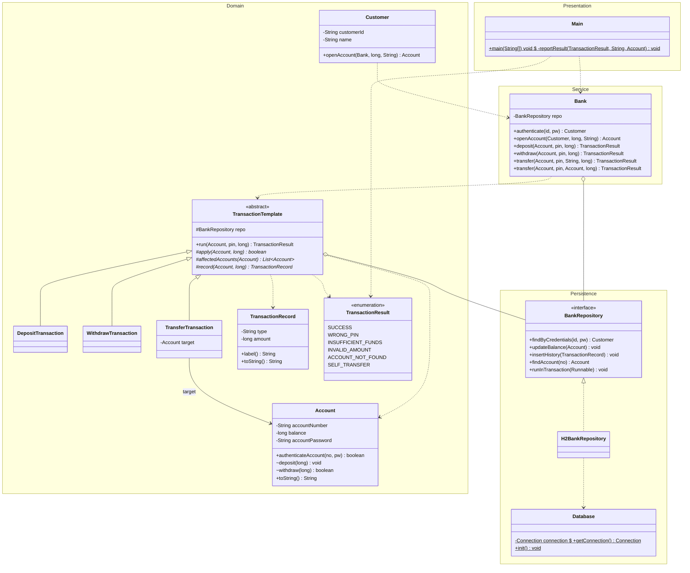
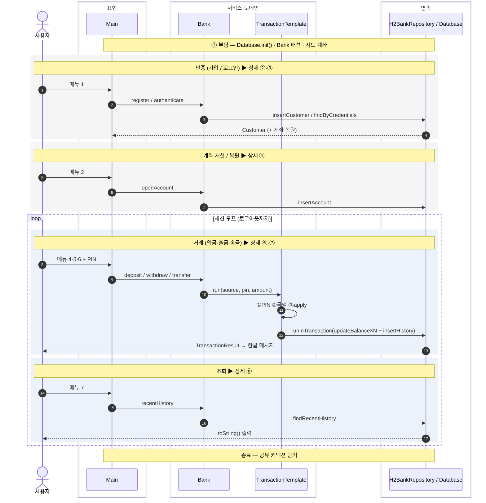
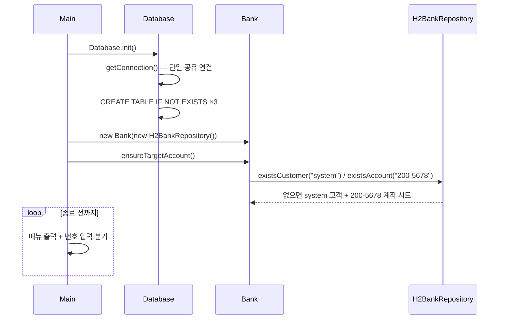
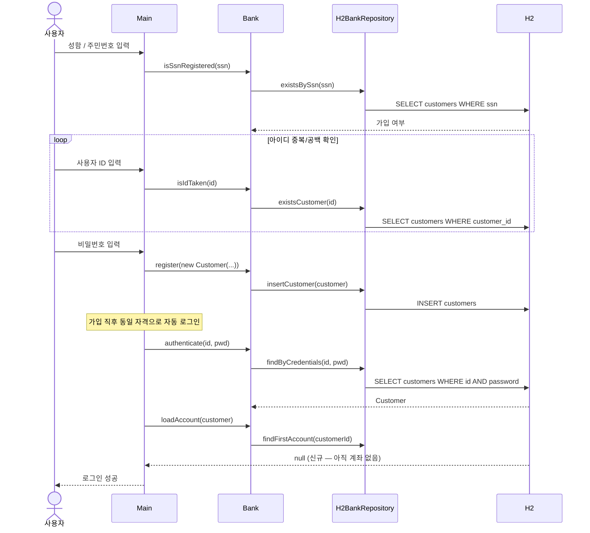
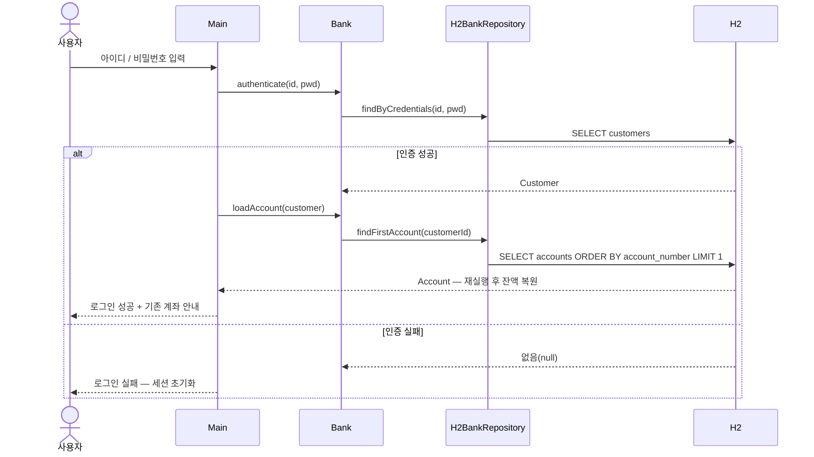
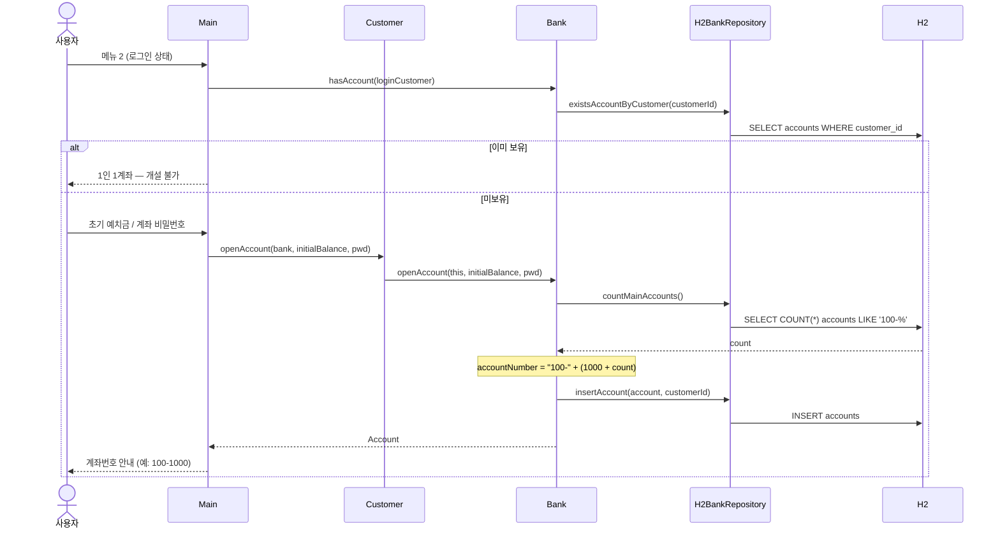
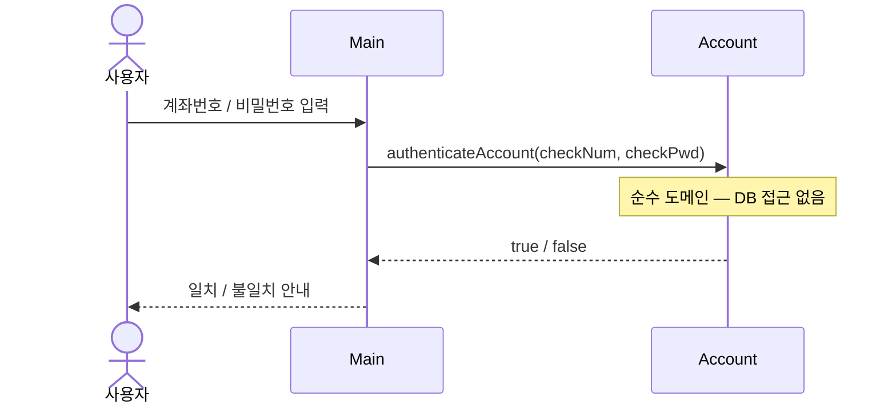
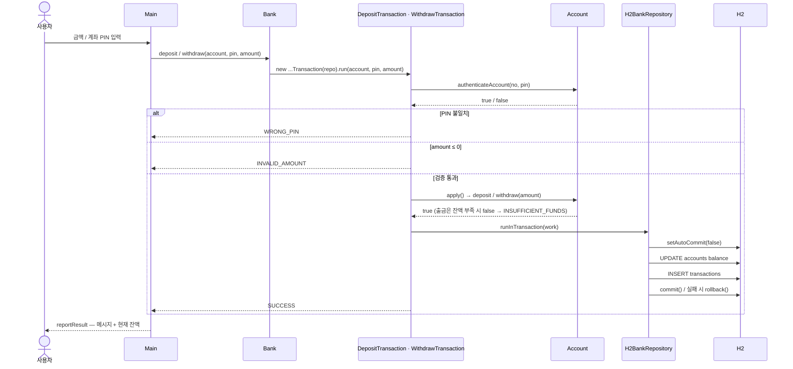
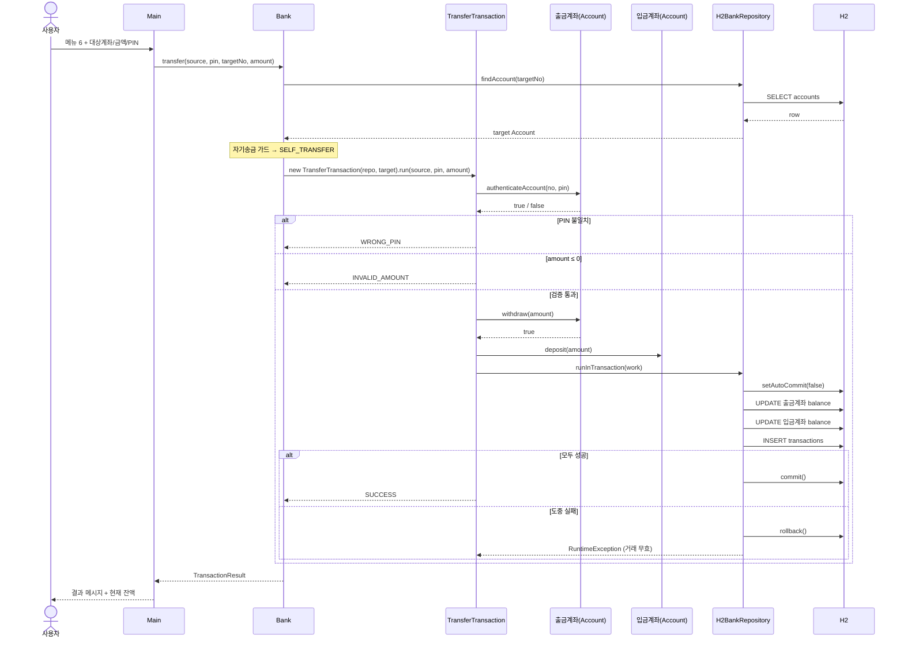
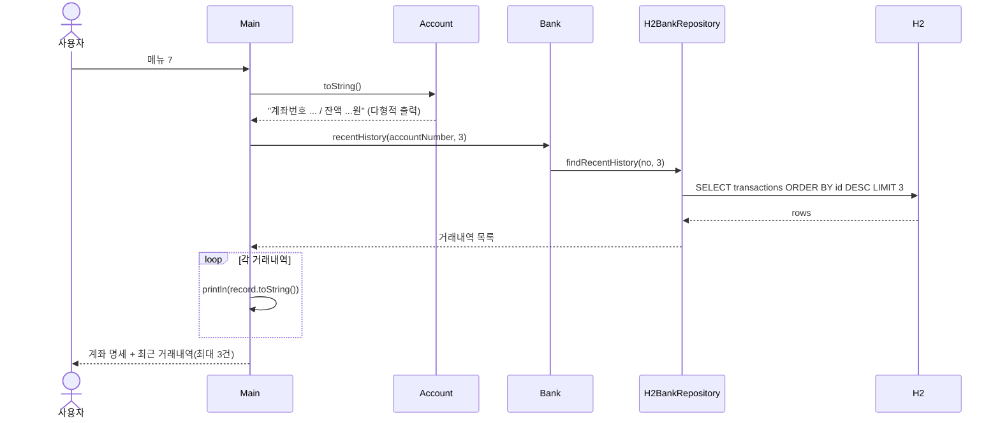

# 은행 전산 시스템 (Banking System)

Java로 구현한 콘솔 기반 은행 전산 시스템입니다. 고객 관리, 계좌 개설, 입금·출금·송금 거래를 지원하며,
모든 데이터는 **H2 임베디드 데이터베이스**에 영구 저장됩니다.

UML 클래스/시퀀스 다이어그램 설계를 기반으로 **SOLID 원칙**에 따라 표현 → 서비스 → 도메인 → 영속의
네 계층으로 분리했고, 거래는 **Template Method(템플릿 메소드) 패턴**, 영속은 **Repository 패턴**으로 구현했습니다.
모든 거래는 **계좌 비밀번호(PIN) 검증 게이트**를 통과해야 하며, 송금처럼 잔액이 여러 계좌에 걸쳐
바뀌는 거래는 **하나의 트랜잭션으로 원자적으로** 처리됩니다.

> 빌드·실행·DB 점검·디버깅 방법은 [CLAUDE.md](CLAUDE.md)에 정리되어 있습니다.
> 이 문서는 **기능 구조와 적용된 객체지향·SOLID·디자인 패턴 개념** 중심입니다.

---

## 주요 기능

| 메뉴 | 기능 | 설명 |
|------|------|------|
| 1 | 로그인 / 회원가입 | 사용자 인증 및 신규 고객 등록 (주민번호·아이디 중복 차단) |
| 2 | 신규 계좌 개설 | 로그인 고객의 계좌 생성 (계좌번호 `100-1000`부터 자동 부여, 1인 1계좌) |
| 3 | 계좌 비밀번호 검증 | 계좌 단위 PIN 사전 확인(`계좌인증`) |
| 4 | 입금 거래 | `DepositTransaction` — **PIN 입력 후** 수행 |
| 5 | 출금 거래 | `WithdrawTransaction` — **PIN 입력 후** 수행 (잔액 부족 시 차단) |
| 6 | 송금 거래 | `TransferTransaction` — **PIN 입력 후** 수행. 대상 계좌번호 입력, 엔터 시 기본값 `200-5678` |
| 7 | 계좌 정보 조회 | 본인 계좌 명세 + 최근 거래내역(최대 3건) 출력 |
| 8 | 종료 | DB 연결 정리 후 종료 |

> **거래 결과**는 `TransactionResult` enum 한 값으로 표현됩니다(Result Object 패턴):
> `SUCCESS` / `WRONG_PIN`(비밀번호 불일치) / `INSUFFICIENT_FUNDS`(잔액 부족) /
> `INVALID_AMOUNT`(금액 오류) / `ACCOUNT_NOT_FOUND`(대상 계좌 없음) / `SELF_TRANSFER`(본인 계좌 송금).
> **실패한 거래는 DB에 흔적을 남기지 않습니다.**

---

## 아키텍처 — 4계층 구조

책임에 따라 네 계층으로 분리하고, 각 계층은 **한 방향(아래로)** 으로만 의존합니다.

```
[표현]   Main                         ── 메뉴/입력/출력, PIN 입력, TransactionResult 분기
   │                                     (시스템에서 콘솔에 출력하는 유일한 계층)
[서비스] Bank                         ── 업무 조율 + 거래 템플릿 디스패치 (출력 없음)
   │      deposit/withdraw/transfer(account, pin, amount) → TransactionResult
   ├──> [도메인] 고객 (Customer) · 계좌 (Account, 순수)
   │             거래 골격 (TransactionTemplate, 추상) ─┬── 입금 (DepositTransaction)
   │                                                     ├── 출금 (WithdrawTransaction)
   │                                                     └── 송금 (TransferTransaction)
   │             거래이력 (TransactionRecord) · TransactionResult (enum)
   └──> [영속]   BankRepository (interface) ──> H2BankRepository ──> Database (H2 연결/스키마)
                 (customers · accounts · transactions 3테이블의 모든 JDBC를 한곳에 격리)
```

**클래스 12개 + `Main`.** 거래·영속의 정합성(원자성)과 OOP 개념 시연을 확보하면서도 설계 제약을 지켰습니다.

### 소스 구성

| 파일 | 계층 | 역할 |
|------|------|------|
| `Main.java` | 표현 | 콘솔 메뉴 루프 + PIN 입력 + 결과 출력 (진입점, 유일한 출력 담당) |
| `Bank.java` | 서비스 | 업무 조율 + 거래 종류에 맞는 템플릿 선택·실행(디스패치) |
| `Customer.java` | 도메인 | 고객 도메인 객체 (순수) |
| `Account.java` | 도메인 | 계좌 도메인 객체 (순수 — DB/출력 없음, 잔액 `long`) |
| `TransactionTemplate.java` | 도메인 | **추상 클래스** — 거래 공통 골격(`final run()`) + 추상 원시연산 3개 |
| `DepositTransaction` / `WithdrawTransaction` / `TransferTransaction` | 도메인 | `TransactionTemplate`을 **상속**해 원시연산(`apply`·`affectedAccounts`·`record`)만 구현 |
| `TransactionRecord.java` | 도메인 | 거래이력 값 객체 + 한글 라벨 + `toString()` |
| `TransactionResult.java` | 도메인 | 거래 결과 enum (Result Object) |
| `BankRepository.java` | 영속 | **인터페이스** — 영속 계약 (3테이블 CRUD + `runInTransaction`) |
| `H2BankRepository.java` | 영속 | `BankRepository`의 H2/JDBC 구현체 (모든 JDBC 격리) |
| `Database.java` | 영속 | H2 단일 공유 연결 관리 + 스키마 초기화 |

---

## UML 다이어그램

### 클래스 다이어그램

> 표현 → 서비스 → 도메인 → 영속의 **4계층을 위에서 아래로** 배치(`direction TB`)하고,
> 각 계층을 `namespace` 박스로 묶었습니다. 의존성 화살표가 모두 아래(또는 추상)를 향합니다.



- **계층 박스(namespace)**: 위에서부터 Presentation(표현) → Service(서비스) → Domain(도메인) → Persistence(영속).
- **상속(▷)**: `TransactionTemplate` ← 세 거래 클래스 (Template Method).
- **실현(▷ 점선)**: `BankRepository` ← `H2BankRepository` (DIP).
- **집약(◇)**: `Bank`·`TransactionTemplate`가 `BankRepository`를 보유.
- **연관(→)**: `TransferTransaction`이 입금 대상 `Account`를 참조.

### 시퀀스 다이어그램 (전체 흐름)

먼저 **0. 전체 구조(개요)** 로 앱 생애주기의 큰 줄기를 보인 뒤, **①~⑧ 상세** 다이어그램에서 각 시나리오를 코드 흐름 그대로 파고듭니다.
`Main`(표현) → `Bank`(서비스) → 거래 템플릿/도메인 → `H2BankRepository`/`Database`(영속)의 계층 호출 방향이 일관됩니다.

> 발표용 팁 — 한 장에 전체를 욱여넣으면 `alt`/`loop` 중첩으로 가독성이 무너지므로(시퀀스 다이어그램은 "1 시나리오 = 1 다이어그램"이 정석),
> 개요 슬라이드로 맥락을 깔고 상세 슬라이드(①~⑧)로 드릴다운하는 구성을 권장합니다. 각 개요 블록의 Note가 대응하는 상세 번호를 가리킵니다.

#### 0. 전체 구조 (개요) — 부팅 → 인증 → 개설 → (거래·조회 루프) → 종료



> ⑤(계좌 비밀번호 검증)은 거래 게이트와 별개인 메뉴 3 단독 흐름이라 개요에서는 생략하고 상세에서만 다룹니다.

#### ① 앱 시작 & 메인 루프



#### ② 회원가입 → 자동 로그인 (메뉴 1-2)



#### ③ 로그인 & 세션·계좌 복원 (메뉴 1-1)



#### ④ 신규 계좌 개설 (메뉴 2)



#### ⑤ 계좌 비밀번호 검증 (메뉴 3 — 순수 도메인, DB 없음)



#### ⑥ 입금 · 출금 (메뉴 4/5 — Template Method 공통 골격)



#### ⑦ 송금 (메뉴 6 — 두 계좌 + 거래내역의 원자적 처리)

가장 복잡한 흐름(PIN 게이트 → 도메인 연산 → 두 계좌+거래내역의 원자적 영속화 → commit/rollback)입니다.



#### ⑧ 계좌 정보 최종 조회 (메뉴 7)



---

## 적용된 객체지향(OOP) 개념

| 개념 | 적용 위치 | 설명 |
|------|-----------|------|
| **캡슐화 (Encapsulation)** | `Account` | 잔액·비밀번호는 `private`. `deposit/withdraw`는 **패키지 전용**이라 외부는 거래 템플릿을 통해서만 잔액을 바꿀 수 있음 |
| **추상화 (Abstraction)** | `TransactionTemplate`(추상 클래스), `BankRepository`(인터페이스) | "무엇을 하는가"(골격/계약)와 "어떻게 하는가"(원시연산/구현체)를 분리. 서비스는 추상화에만 의존 |
| **상속 + 오버라이딩 (다형성)** | `TransactionTemplate` ← 세 거래, `Account/TransactionRecord.toString()` | 추상 클래스를 **상속**해 원시연산만 재정의하고, `Object.toString()` 재정의로 `println(account)`처럼 **다형적**으로 출력 |
| **메서드/생성자 오버로딩 (컴파일타임 다형성)** | `Bank.transfer(...)`, `Account(...)` | `transfer`는 대상을 **계좌번호(String)** 로도, **이미 가진 Account 객체**로도 받음. `Account`는 잔액 `0L` 기본 생성자와 초기 잔액 생성자 2형태 |

---

## 적용된 SOLID 원칙

- **SRP (단일 책임)** — 계층별로 책임을 하나씩만 가집니다. 출력은 `Main`만, 업무 조율은 `Bank`만,
  JDBC는 `H2BankRepository`만, 잔액 상태 변경은 `Account`만 담당합니다. 거래 골격의 도메인 연산(`apply`)은
  **DB를 모르는 순수 연산**이고, `Account`도 DB/출력을 가지지 않는 **순수 객체**입니다.
- **OCP (개방-폐쇄)** — 새 거래 종류는 `TransactionTemplate`을 **상속**한 클래스를 추가하기만 하면 되고,
  `run()` 골격이나 기존 거래는 **수정하지 않습니다**. 거래 종류→한글 라벨 매핑도 `TransactionRecord`
  한곳에 모아 변경 파급을 막았습니다.
- **LSP (리스코프 치환)** — 세 거래 클래스는 모두 `TransactionTemplate.run()` 계약(검증→연산→영속화)을
  지키므로, 어떤 하위형으로 바꿔도 골격이 동일하게 동작합니다.
- **DIP (의존성 역전)** — `Bank`와 거래 템플릿은 구체 클래스가 아닌 **`BankRepository` 인터페이스**에만
  의존합니다. H2 대신 InMemory 구현으로 갈아끼워도 핵심 로직은 **바뀌지 않습니다**(배선은 `Main` 한 줄).
- **ISP (인터페이스 분리)** — 표현·서비스 계층은 필요한 추상(`BankRepository`)에만 의존하고 JDBC·커넥션
  세부는 보지 않습니다. `BankRepository`는 영속에 필요한 연산만 노출합니다.

---

## 적용된 디자인 패턴

### 1. Template Method (템플릿 메소드) 패턴 — 거래 골격
세 거래(`deposit/withdraw/transfer`)는 **①PIN 검증 → ②금액 검증 → ③도메인 연산 → ④원자적 영속화**라는
같은 골격을 가집니다. 이 뼈대를 `TransactionTemplate.run()`에 **`final`로 고정**해 어떤 하위 클래스도
순서를 바꾸거나 단계를 건너뛸 수 없게 하고, **거래마다 달라지는 부분만 추상 원시연산으로 위임**합니다.

```java
public final TransactionResult run(Account source, String pin, long amount) {
    if (!source.authenticateAccount(source.getAccountNumber(), pin))
        return TransactionResult.WRONG_PIN;            // ① 공통 — PIN 게이트
    if (amount <= 0)
        return TransactionResult.INVALID_AMOUNT;       // ② 공통 — 금액 검증
    if (!apply(source, amount))                        // ③ 가변 — 순수 도메인 연산
        return TransactionResult.INSUFFICIENT_FUNDS;
    repo.runInTransaction(() -> {                      // ④ 가변 대상 — 원자적 영속화
        for (Account a : affectedAccounts(source)) repo.updateBalance(a);
        repo.insertHistory(record(source, amount));
    });
    return TransactionResult.SUCCESS;
}
protected abstract boolean apply(Account source, long amount);          // 잔액 변경(순수)
protected abstract List<Account> affectedAccounts(Account source);      // 영속 대상
protected abstract TransactionRecord record(Account source, long amount); // 거래 기록
```

- 입금/출금은 `affectedAccounts`가 자기 계좌 1개, 송금은 출금·입금 계좌 2개를 돌려줘 **한 트랜잭션으로** 갱신됩니다.
- 검증 로직 중복 제거와 송금 원자성을 **하나의 골격**으로 동시에 해결합니다.
- `③ apply()`는 `BankRepository`를 모르는 **순수 도메인 연산**이라, 템플릿이 영속을 떠안아도 도메인은 깨끗하게 유지됩니다.

### 2. Repository 패턴 + 트랜잭션 경계 — 영속 원자성
모든 JDBC는 `H2BankRepository` 한 클래스에 격리됩니다. 송금처럼 **두 계좌의 잔액 + 거래내역**이
함께 바뀌는 작업은 `runInTransaction(Runnable)`으로 감싸 **단일 공유 H2 커넥션** 위에서
`auto-commit`을 끄고 실행합니다 — 전부 성공하면 `commit`, 도중 실패하면 `rollback`. 덕분에
"출금만 반영되고 입금은 누락되는 돈 증발"이 원천 차단됩니다.

### 3. Result Object 패턴 — `TransactionResult`
거래 한 건의 처리 결과를 **예외가 아닌 enum 한 값**으로 표현합니다. 서비스는 값만 반환하고,
한글 메시지 매핑은 표현 계층(`Main`)이 담당해 계층 경계를 깔끔하게 유지합니다.

---

## 핵심 설계 결정

- **PIN 검증 게이트 (보안)** — 모든 거래는 `TransactionTemplate.run()` 첫 단계에서
  `계좌인증(authenticateAccount)`을 통과해야 합니다. 검증을 **거래 골격에서 강제**하므로 UI를 우회해도
  뚫리지 않습니다. (메뉴 3은 별도 '사전 확인' 용도)
- **불변식은 서비스에** — "본인 계좌로 송금 금지"를 `Bank.transfer` 첫머리에 두어, 서비스 직접 호출 시에도
  `SELF_TRANSFER`로 차단합니다(UI 가드는 조기 안내용 보조).
- **금액은 `long` (원 단위 정수)** — 부동소수점 오차를 없애고 DB(`BIGINT`)와 타입을 일치시켰습니다.
- **실패는 흔적 없음** — `apply()`가 성공한 뒤에만 영속화하므로, 실패한 거래(PIN 오류·잔액 부족·금액 오류·
  계좌 없음·자기송금)는 잔액도 거래내역도 바꾸지 않습니다.
- **인증 구분** — `사용자인증`(은행 단위 로그인)과 `계좌인증`(계좌 단위 PIN 검증)을 분리합니다.

---

## 사용 흐름 (영속화 검증)

1. 메뉴 `1` 회원가입 → 자동 로그인
2. 메뉴 `2` 계좌 개설 (예: 초기 예치금 10000원, 계좌 비밀번호 설정)
3. 메뉴 `4`→`5`→`6` 입금·출금·송금 — **각 거래마다 계좌 비밀번호 입력**
4. 메뉴 `8` 종료 → **프로그램 재실행** 후 같은 아이디로 로그인 → 메뉴 `7` 조회 시
   종료 전 잔액과 최근 거래내역이 그대로 유지됨을 확인

비밀번호가 틀리면 거래가 취소되어 잔액·거래내역이 변하지 않습니다. 송금(메뉴 6)은 대상 계좌번호를
입력하면 해당 계좌로, 비우고 엔터 시 기본 가상 계좌(`200-5678`)로 이체됩니다.
